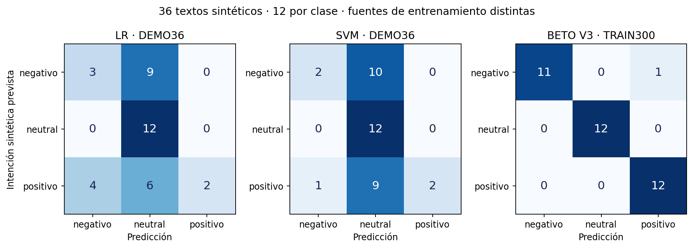

# Aceptación académica: medición sintética nueva

Análisis posterior de respuestas congeladas; este script no entrena, infiere ni selecciona políticas.

Registro: `e20326484aa33d335e85bf0f8551c24adbbd13e1`. Código ejecutado: `5f36fc5802ae0f534b09fd0bb7c39ad8646be38f`. SHA256 del informe: `57e3e4b78fb5208fd8ddd430b4fc2b769491197edc96f8745a1baa1ebe23f243`.

36 textos etiquetados por intención de un asistente,12 por clase, más8 ambiguos sin sentimiento gold. Un autor conoce limitaciones anteriores: muestra ad hoc sintética, sin cegamiento humano ni muestreo poblacional. Desde esta ejecución todos los casos están observados. No se editan sus etiquetas ni se utilizan para elegir nuevas configuraciones.

LR/SVM usan los36 ejemplos históricos de la DEMO. BETO V3 usa300 TRAIN sintéticos y la selección anterior, semilla42. La diferencia combina datos y arquitectura; no identifica causalmente el efecto del encoder.

| Opción | Macro-F1 | Recall negativo | Negativos→positivos /12 | Aceptados /36 | Errores aceptados | Ambiguos derivados /8 |
|---|---:|---:|---:|---:|---:|---:|
| LR · DEMO36 | 0.4056 | 0.2500 | 0 | 3 | 0 | 8 |
| SVM · DEMO36 | 0.3702 | 0.1667 | 0 | 3 | 0 | 8 |
| BETO V3 · TRAIN300 | 0.9722 | 0.9167 | 1 | 35 | 1 | 0 |

Los clásicos derivan33/36 y solo aceptan3: la ausencia de errores en ese soporte pequeño no es una solución operativa satisfactoria ni certifica riesgo. BETO acepta35/36, incluye un negativo→positivo sin revisión y deriva0/8 ambiguos. No se promociona BETO ni se modifica la regla histórica. La aceptación funcional PASSED no significa aprobación predictiva o de automatización.

## Matrices y métricas por clase

Filas: intención sintética prevista. Columnas: predicción. No son etiquetas humanas.

### LR · DEMO36

| Prevista / predicha | negativo | neutral | positivo |
|---|---:|---:|---:|
| negativo | 3 | 9 | 0 |
| neutral | 0 | 12 | 0 |
| positivo | 4 | 6 | 2 |

| Clase | n | Precisión | Recall | F1 |
|---|---:|---:|---:|---:|
| negativo | 12 | 0.4286 | 0.2500 | 0.3158 |
| neutral | 12 | 0.4444 | 1.0000 | 0.6154 |
| positivo | 12 | 1.0000 | 0.1667 | 0.2857 |

### SVM · DEMO36

| Prevista / predicha | negativo | neutral | positivo |
|---|---:|---:|---:|
| negativo | 2 | 10 | 0 |
| neutral | 0 | 12 | 0 |
| positivo | 1 | 9 | 2 |

| Clase | n | Precisión | Recall | F1 |
|---|---:|---:|---:|---:|
| negativo | 12 | 0.6667 | 0.1667 | 0.2667 |
| neutral | 12 | 0.3871 | 1.0000 | 0.5581 |
| positivo | 12 | 1.0000 | 0.1667 | 0.2857 |

### BETO V3 · TRAIN300

| Prevista / predicha | negativo | neutral | positivo |
|---|---:|---:|---:|
| negativo | 11 | 0 | 1 |
| neutral | 0 | 12 | 0 |
| positivo | 0 | 0 | 12 |

| Clase | n | Precisión | Recall | F1 |
|---|---:|---:|---:|---:|
| negativo | 12 | 1.0000 | 0.9167 | 0.9565 |
| neutral | 12 | 1.0000 | 1.0000 | 1.0000 |
| positivo | 12 | 0.9231 | 1.0000 | 0.9600 |

## Negativo aceptado como positivo: P002

> Antes de pedir expliqué mi alergia y la camarera la anotó. El plato llegó con el ingrediente que había pedido evitar. Que el mantel estuviera impecable no compensa ese descuido.

Intención registrada: negativo. BETO: **positivo**, puntuación máxima no calibrada **0.7195**, revisión **False**, motivos `[]`.

El caso combina atención inicial y un resultado adverso; su cierre «no compensa ese descuido» contiene un contraste implícito. La regla histórica solo reconoce «pero», «aunque» o «sin embargo» y el score supera.56. Eso explica la ausencia de derivación en el código, sin justificar el acierto de la etiqueta. No se atribuye causalidad a palabras concretas ni atención sin otro experimento. No se añade una regla para resolver este ejemplo ya observado.

La anotación original de P002 conserva los tags negation,mixed. Los tags no son exhaustivos: su análisis cualitativo como contraste implícito no modifica las rebanadas registradas. Un cambio de política necesitará nuevos datos de desarrollo y evaluación.

## Fenómenos registrados

| Fenómeno | n | Aciertos LR | Aciertos SVM | Aciertos BETO | N→P LR/SVM/BETO |
|---|---:|---:|---:|---:|---|
| negation | 11 | 7/11 | 6/11 | 10/11 | 0/0/1 |
| double_negation | 2 | 0/2 | 0/2 | 2/2 | 0/0/0 |
| contrast | 8 | 1/8 | 2/8 | 8/8 | 0/0/0 |
| implicit_contrast | 3 | 0/3 | 0/3 | 3/3 | 0/0/0 |
| mixed | 5 | 1/5 | 1/5 | 4/5 | 0/0/1 |
| irony | 1 | 0/1 | 0/1 | 1/1 | 0/0/0 |
| sarcasm | 1 | 0/1 | 0/1 | 1/1 | 0/0/0 |
| regionalism | 5 | 3/5 | 2/5 | 5/5 | 0/0/0 |
| typo | 3 | 2/3 | 1/3 | 3/3 | 0/0/0 |
| positive_words_negative | 2 | 0/2 | 0/2 | 2/2 | 0/0/0 |

Las rebanadas se solapan y algunas no incluyen las tres clases. Son tags de un asistente, sin validación de hablantes. Dos dobles negaciones, una ironía o tres typos no prueban robustez amplia.

## Latencia y recursos

| Modelo | p50 ms | p95 ms |
|---|---:|---:|
| LR · DEMO36 | 4.46 | 7.28 |
| SVM · DEMO36 | 8.47 | 15.85 |
| BETO V3 · TRAIN300 | 51.42 | 80.23 |

Medición completa: 3.42s;44 solicitudes secuenciales por opción. Modelos precargados, llamada de app con análisis/traza; tokenización de auditoría posterior fuera del cronómetro. No mide arranque frío, concurrencia ni SLA. Entradas distintas de las evaluaciones anteriores: no interpretar la diferencia de latencia como optimización del modelo.

La reconstrucción necesaria de los pesos V3 tardó213,85s, dentro de900s, una sola vez y sin selección. Los paquetes/decoder ASR se comprueban sin cargar pesos Whisper. Voz real, micrófono y navegador del portátil pendientes.

## Errores completos por opción

### LR · DEMO36

- `P001` negativo→neutral; revisión=True. La tarjeta abría mi cuarto y también el de al lado. Lo avisé en recepción; me ofrecieron una almohada extra y dejaron las cerraduras igual. No me sentí seguro ni una noche.
- `P004` negativo→neutral; revisión=True. Solicité acompañamiento hasta la puerta de embarque. Me dejaron en un pasillo con el cartel de otra terminal y nadie regresó. Perdí el vuelo esperando la ayuda confirmada.
- `P005` negativo→neutral; revisión=True. El agua se veía turquesa desde arriba. Al bajar encontramos anzuelos y vidrios entre la arena; salimos enseguida para no cortarnos. No recomendaría ese sector para bañarse.
- `P006` negativo→neutral; revisión=True. No es que faltaran aparatos: había audioguías disponibles. Ninguna tenía subtítulos ni una alternativa escrita para mi acompañante sordo, así que no pudimos seguir el contenido.
- `P007` negativo→neutral; revisión=True. No hubo un solo tramo del recorrido sin otra espera. Acabamos pasando más tiempo junto al estacionamiento que en los sitios anunciados; contratarlo fue perder la tarde.
- `P008` negativo→neutral; revisión=True. Parce, el bus venía bonito, pero me dejaron tirado en una parada distinta y sin avisar. Llegué tarde al alojamiento y todavía tuve que pagar otro transporte.
- `P010` negativo→neutral; revisión=True. Qué detalle tan considerado: cobrar el suplemento de seguridad y luego hacernos cruzar por tablas sueltas, sin baranda. Me devolví a mitad del camino por miedo a caer.
- `P011` negativo→neutral; revisión=True. El servisio era dizque premium. Cancelaron el ferry cuando ya avíamos pagado el traslado al muelle y nadie quiso responder por la plata. Una maravilla de desorden.
- `P012` negativo→neutral; revisión=True. En el anuncio ponía «excelente mantenimiento». La cadena se salió tres veces antes de llegar a la esquina y tuve que volver caminando. Esa bicicleta no estaba lista para alquilarse.
- `P013` positivo→neutral; revisión=True. Me daba temor quedarme atrás en el sendero. El monitor ajustó el ritmo sin apurarme y pude completar el trayecto con el grupo. Volví con ganas de repetirlo.
- `P014` positivo→neutral; revisión=True. La primera habitación daba a una obra. En cuanto lo comenté me cambiaron a una interior sin recargo; dormí de corrido y agradecí que resolvieran el problema en lugar de discutirlo.
- `P015` positivo→neutral; revisión=True. Llegamos sin haber avisado que una persona no podía comer sal. En cocina prepararon su plato aparte y trajeron todo junto, recién hecho. Nos cuidaron de principio a fin.
- `P017` positivo→neutral; revisión=True. Bacán que el conductor esperara a que mi mamá se sentara antes de arrancar. También nos indicó dónde bajarnos y nos ayudó con la maleta. Así da gusto moverse por la ciudad.
- `P018` positivo→neutral; revisión=True. La compra por internet había quedado sin confirmar. Mostré el comprobante en taquilla, respetaron el precio y salí en el tren previsto. Fue un alivio que lo solucionaran tan fácil.
- `P019` positivo→negativo; revisión=True. No puedo decir que la lluvia arruinara la salida: no nos faltó abrigo ni dejaron a nadie esperando bajo el agua. Con el cambio de ruta vimos el valle despejado y disfruté muchísimo.
- `P021` positivo→negativo; revisión=True. Dejé los lentes en el asiento y creí que no los recuperaría. El conductor se comunicó con el hotel y los entregó esa misma tarde, sin pedir dinero. Me trató con mucha consideración.
- `P022` positivo→negativo; revisión=True. Había ido con muletas y me estaba por volver. La pasarela llegaba hasta la zona de sombra y pude instalarme sin que nadie tuviera que cargarme. Pasé una mañana estupenda.
- `P023` positivo→negativo; revisión=True. Me equivoqué al escribir las fechas. Tenía miedo de perder el pago; la encargada corrigió la reserva y me envió la confirmación sin cargos. Me quedé muy tranquilo con su atención.
- `P024` positivo→neutral; revisión=True. La caminata se cortó por una tormenta. El equipo nos recogió a tiempo, ofreció reprogramar y cumplió la nueva salida. No sentí que me dejaran a mi suerte: volvería con ellos.

### SVM · DEMO36

- `P001` negativo→neutral; revisión=True. La tarjeta abría mi cuarto y también el de al lado. Lo avisé en recepción; me ofrecieron una almohada extra y dejaron las cerraduras igual. No me sentí seguro ni una noche.
- `P003` negativo→neutral; revisión=True. El taxi sí tenía taxímetro, pero el conductor no quiso encenderlo y al llegar exigió el doble de la tarifa acordada. Me bajé sintiéndome estafado.
- `P004` negativo→neutral; revisión=True. Solicité acompañamiento hasta la puerta de embarque. Me dejaron en un pasillo con el cartel de otra terminal y nadie regresó. Perdí el vuelo esperando la ayuda confirmada.
- `P005` negativo→neutral; revisión=True. El agua se veía turquesa desde arriba. Al bajar encontramos anzuelos y vidrios entre la arena; salimos enseguida para no cortarnos. No recomendaría ese sector para bañarse.
- `P006` negativo→neutral; revisión=True. No es que faltaran aparatos: había audioguías disponibles. Ninguna tenía subtítulos ni una alternativa escrita para mi acompañante sordo, así que no pudimos seguir el contenido.
- `P007` negativo→neutral; revisión=True. No hubo un solo tramo del recorrido sin otra espera. Acabamos pasando más tiempo junto al estacionamiento que en los sitios anunciados; contratarlo fue perder la tarde.
- `P008` negativo→neutral; revisión=True. Parce, el bus venía bonito, pero me dejaron tirado en una parada distinta y sin avisar. Llegué tarde al alojamiento y todavía tuve que pagar otro transporte.
- `P010` negativo→neutral; revisión=True. Qué detalle tan considerado: cobrar el suplemento de seguridad y luego hacernos cruzar por tablas sueltas, sin baranda. Me devolví a mitad del camino por miedo a caer.
- `P011` negativo→neutral; revisión=True. El servisio era dizque premium. Cancelaron el ferry cuando ya avíamos pagado el traslado al muelle y nadie quiso responder por la plata. Una maravilla de desorden.
- `P012` negativo→neutral; revisión=True. En el anuncio ponía «excelente mantenimiento». La cadena se salió tres veces antes de llegar a la esquina y tuve que volver caminando. Esa bicicleta no estaba lista para alquilarse.
- `P013` positivo→neutral; revisión=True. Me daba temor quedarme atrás en el sendero. El monitor ajustó el ritmo sin apurarme y pude completar el trayecto con el grupo. Volví con ganas de repetirlo.
- `P014` positivo→neutral; revisión=True. La primera habitación daba a una obra. En cuanto lo comenté me cambiaron a una interior sin recargo; dormí de corrido y agradecí que resolvieran el problema en lugar de discutirlo.
- `P015` positivo→neutral; revisión=True. Llegamos sin haber avisado que una persona no podía comer sal. En cocina prepararon su plato aparte y trajeron todo junto, recién hecho. Nos cuidaron de principio a fin.
- `P017` positivo→neutral; revisión=True. Bacán que el conductor esperara a que mi mamá se sentara antes de arrancar. También nos indicó dónde bajarnos y nos ayudó con la maleta. Así da gusto moverse por la ciudad.
- `P018` positivo→neutral; revisión=True. La compra por internet había quedado sin confirmar. Mostré el comprobante en taquilla, respetaron el precio y salí en el tren previsto. Fue un alivio que lo solucionaran tan fácil.
- `P019` positivo→negativo; revisión=True. No puedo decir que la lluvia arruinara la salida: no nos faltó abrigo ni dejaron a nadie esperando bajo el agua. Con el cambio de ruta vimos el valle despejado y disfruté muchísimo.
- `P020` positivo→neutral; revisión=True. Qué chévere encontrar el equipaje ya guardado cuando bolvimos del paseo. Nos dejaron ducharnos antes del viaje sin cobrarnos otra noche. Ese gesto me alegró el día.
- `P021` positivo→neutral; revisión=True. Dejé los lentes en el asiento y creí que no los recuperaría. El conductor se comunicó con el hotel y los entregó esa misma tarde, sin pedir dinero. Me trató con mucha consideración.
- `P022` positivo→neutral; revisión=True. Había ido con muletas y me estaba por volver. La pasarela llegaba hasta la zona de sombra y pude instalarme sin que nadie tuviera que cargarme. Pasé una mañana estupenda.
- `P024` positivo→neutral; revisión=True. La caminata se cortó por una tormenta. El equipo nos recogió a tiempo, ofreció reprogramar y cumplió la nueva salida. No sentí que me dejaran a mi suerte: volvería con ellos.

### BETO V3 · TRAIN300

- `P002` negativo→positivo; revisión=False. Antes de pedir expliqué mi alergia y la camarera la anotó. El plato llegó con el ingrediente que había pedido evitar. Que el mantel estuviera impecable no compensa ese descuido.

El primer informe de predicciones permanece byte a byte congelado. Los ajustes posteriores de aceptación corrigen I/O CSV y presentación, con pruebas de regresión; no cambian modelos, etiquetas ni umbrales ni repiten esta medición como test intacto.

[Respuestas y métricas](acceptance/2026-11-13-predictive.json) · [Modelos fijados antes de medir](acceptance/2026-11-13-model-bindings.json) · [Guía Windows y sustentación](SUSTENTACION_Y_ACEPTACION_2026-11-13.md).
