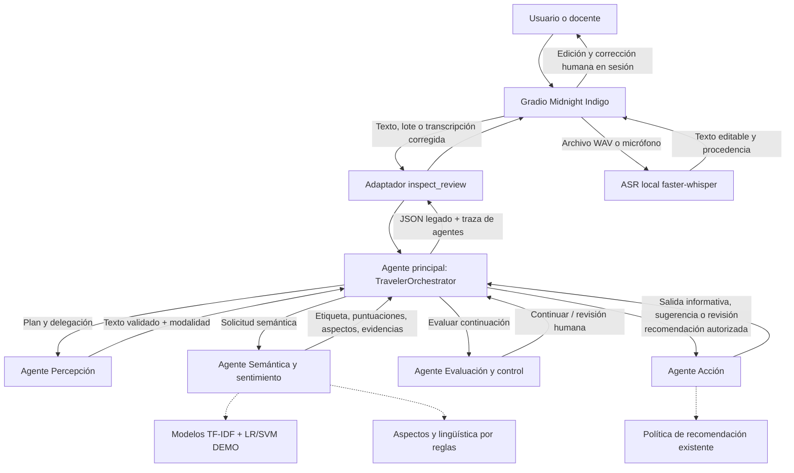

# Arquitectura jerárquica multiagente — Traveler Insights 2026

**Incremento mínimo real; sin LLM externos ni servicios adicionales.** Contrato público anterior: `inspect_review(text, model, *, review_id="", threshold=.56)` permanece compatible. El nuevo `multiagente` es una clave JSON **aditiva**, no elimina ni cambia claves anteriores.

## 1. Diagnóstico de reutilización

| Componente existente | Nueva ubicación en el flujo | Estado |
|---|---|---|
| `app.py` Gradio Midnight Indigo | Adaptador de interfaz; invoca `inspect_review` como antes | Sin modificaciones |
| `audio_asr.py` | Percepción conserva ASR/validación WAV y corrección editable; pasa modalidad a orquestador | Solo dos argumentos adicionales al adaptador |
| `aspects.py`, `linguistic.py` | Agente semántico: aspectos, fragmentos literales, señales lingüísticas | Funciones reutilizadas sin cambiar |
| `model.py`, LR/SVM | Agente semántico: inferencia DEMO, puntuaciones sin calibrar | Ningún reentrenamiento ni cambio de modelo |
| `policy.py` | Agente acción: política existente y prohibición de acciones externas | Sin modificaciones |
| `batch.py` | Llamadas repetidas al adaptador `inspect_review`, exportaciones sin cambios | Sin modificaciones |
| Corpus, benchmarks, pruebas históricas | Separados de orquestación en tiempo de inferencia | Congelados, sin tocar |

Se reutiliza el estado transitorio de Gradio para ediciones/correcciones. La traza multiagente describe una ejecución, **no memoria persistente ni aprendizaje en línea**.

## 2. C4 nivel de componentes (sistema local)



Los mensajes son pares **delegación → resultado estructurado → validación**, no llamadas directas entre especialistas: el **orquestador es el coordinador jerárquico único**, resuelve dependencias, autoriza avanzar y registra cada intervención.

## 3. Contratos internos y capacidades

`Message(sender, recipient, task, payload)` exige tarea válida. `Execution` mantiene `state`, `plan`, `results`, `trace` para **cada ejecución independiente**.

| Agente | Observación/entrada | Acción interna permitida | Resultado estructurado | Autonomía/límite |
|---|---|---|---|---|
| Orquestador | solicitud y ejecución actual | generar plan fijo, delegar, validar, decidir gates y detener | estado terminal, respuesta y traza | no entrena ni realiza solicitudes de red |
| Percepción | `text`, `modality`, `review_id`, `edited_by_human` | validar no vacío, longitud máxima, modalidad, normalizar espacios externos | `text`, `review_id`, `modality`, `edited_by_human` | ASR está encapsulado en UI/preprocesamiento |
| Semántica | texto validado | predict_proba LR/SVM, extraer aspectos, evidencias literales, señales | `sentiment`, `scores`, `confidence_raw`, `aspects`, `evidence`, `linguistic_profile`, `contrast` | no atribuir causalidad, ABSA ni probabilidades calibradas |
| Control | salida semántica | validar política de baja puntuación y contraste; marcar revisión | `needs_human`, `decision`, `reason_codes` | no corrige etiquetas ni reentrena |
| Acción | semántica + control | ejecutar `policy.recommend` como cálculo local | `policy_state`, `recommendation`, `external_actions_executed=False` | no interactúa con hoteles, servicios, reservas ni sistemas externos |

Las puntuaciones son señales internas no calibradas. El control conserva exactamente los umbrales del prototipo anterior: puntuación máxima inferior a 0,56; o contraste léxico con puntuación inferior a 0,80. No se inventó un sistema de confianza válido externamente.

## 4. Estados, plan y gates

```mermaid
stateDiagram-v2
  [*] --> CREADO
  CREADO --> EJECUTANDO: plan [percepcion, semantica, control, accion]
  EJECUTANDO --> EJECUTANDO: mensaje validado + continuar
  EJECUTANDO --> DETENIDO_SEGURO: entrada, contrato, modelo o política inválidos
  EJECUTANDO --> REVISION_HUMANA: control solicita revisión; acción devuelve abstención
  EJECUTANDO --> COMPLETADO: resultado autorizado sin revisión
  COMPLETADO --> [*]
  REVISION_HUMANA --> [*]
  DETENIDO_SEGURO --> [*]
```



**Nota sobre fallo parcial:** un fallo detiene delegaciones sucesivas y emite un error genérico (sin texto privado ni recomendación). La clase `AgentFailure` conserva compatibilidad con ValueError. En la primera versión la traza de error permanece en el estado interno de la ejecución y **no se retorna una respuesta parcial** al usuario; error visible por la UI. Puede incorporarse más adelante una traza de error sanitizada persistida en memoria de sesión, solo con revisión de privacidad.

**Trazabilidad:** se registran nombre de agente, tarea, estado, secuencia, claves de entrada/salida y código de paso. **No se duplican reseñas, transcripciones, rutas de audio, valores de atributos ni secretos** en la traza. La respuesta estándar ya contiene texto/evidencias cuando corresponde; el campo `multiagente` añade la traza estructurada para demostrar coordinación.

## 5. Caso de extremo a extremo

Situación inicial: un visitante escribe «El guía fue amable, pero esperamos demasiado para entrar».

1. Gradio envía texto y modelo LR/SVM al adaptador.
2. Orquestador crea plan de cuatro especialistas y estado `EJECUTANDO`.
3. Percepción valida texto y modalidad.
4. Semántica obtiene etiqueta y scores DEMO, aspectos `servicio` y `espera`, evidencia literal y contraste.
5. Control evalúa puntuación no calibrada y contraste, activa `SOLICITAR_REVISION` cuando corresponde.
6. Acción consulta la política original; devuelve `revisión_humana` sin reservar, contactar o modificar servicios.
7. Orquestador valida salida y marca `REVISION_HUMANA`; devuelve **todos los campos originales** y `multiagente.traza`.

Las etiquetas concretas son dependientes del modelo DEMO. No se presenta resultado como correcto gold: la docente puede comprobar la traza mediante el JSON de la interfaz o CLI.

### Demostración offline (Python 3.12)

```powershell
git fetch origin
git switch --track origin/feat/hierarchical-multiagent-orchestrator
.\.venv\Scripts\python.exe -m pip install -e ".[ui,test]"
.\.venv\Scripts\python.exe -m pytest -q
.\.venv\Scripts\python.exe -m traveler_agent.multiagent --text "El guía fue amable, pero esperamos demasiado para entrar." --model lr
.\.venv\Scripts\python.exe app.py
```

En Gradio abrir la pestaña de reseña, ejecutar y expandir **Trazabilidad completa · JSON**; buscar `multiagente`, `plan`, `traza` y `estado`. Para audio, grabar/transcribir/corregir y analizar; `procedencia_entrada` sigue intacta y `multiagente.modalidad_percibida` cambia a `audio_transcrito`. Para lotes, cada reseña tiene su traza individual y se conservan las exportaciones y correcciones.

## 6. Matriz de cumplimiento — rúbrica de IA UTB

| Requisito | Evidencia | Límite honesto |
|---|---|---|
| Problema/usuario | opiniones de visitantes y operador humano | no usuarios reales reclutados |
| Percepción | texto o voz editada y validada por agente de percepción | ASR en preprocesador, no emoción de voz |
| Razonamiento/planificación | plan y gates de orquestador, delegación explícita por estado | plan fijo condicionado por política; no búsqueda óptima ni planificador dinámico |
| Decisión y acción | control de incertidumbre + política determinista de recomendación | sugerencia informativa, sin actuar sobre terceros |
| Memoria | `Execution.results` y `trace` de **una ejecución** y estados Gradio | memoria episódica efímera; sin almacenamiento a largo plazo |
| Aprendizaje | LR/SVM aprendidos **antes** del uso; experimentos sintéticos offline | no aprendizaje continuo, no se modifican modelos por corrección humana |
| Caso completo | demo texto y audio, secuencia de 10 eventos, JSON visible | scores no calibrados |
| Trazabilidad/fallos | test de 4 delegaciones, entradas/salidas, interrupción segura | no hay reintentos distribuidos ni persistencia externa |
| Sesgos y límites | documentos de experimentos, tasas de confusión en desafío | no validación auténtica ni ABSA contextual |

## 7. Pendientes explícitos

- Validación real con reseñas humanas autorizadas y anotación independiente (datos auténticos).
- Evaluación del orquestador sobre casos de fallo real de ASR; actualmente ASR local tiene tests simulados y una prueba manual WAV reportada.
- Monitoreo de privacidad y persistencia controlada solo si la rúbrica lo exige; no confundir bitácora local con entrenamiento.
- Evaluación de reglas de seguridad y aspectos a partir de corpus auténtico, sin alterar los dos experimentos sintéticos históricos (PR #12/#13).
- No agregar Transformers, RAG, clustering, agentes externos o nuevas dependencias.

**Separación estricta:** este PR solo cambia coordinación y adaptador, no datos, modelos entrenados, corpus ni resultados de Macro-F1 históricos (1,00 y aproximadamente 0,39 en dos conjuntos sintéticos diferentes).
