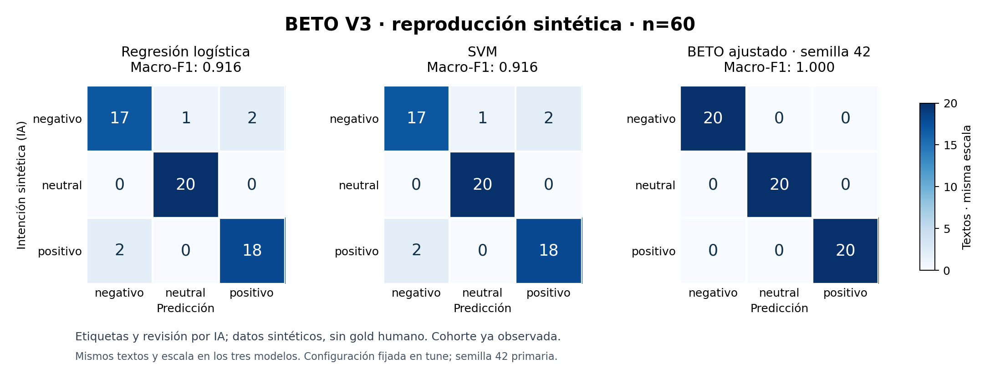

# BETO V3: piloto de calidad y plan de ampliación a 5.000

Investigación del **10 de noviembre de 2026**. Se construyó un primer corpus operativo de **564 borradores sintéticos**, antes de comprometer la generación y el entrenamiento de 5.000. Dos casos ambiguos se excluyeron tras adjudicación: quedan **562 muestras admitidas**, de las cuales 540 tienen sentimiento previsto y 22 solo expectativa de revisión. No hay turistas reales, anotación humana ni métricas humanas en esta fase.


Actualización operativa del **13 de noviembre de 2026**: PR #26 ya está fusionado; main verificado `1628df6fe9a1c9ee68ab34096444177ba4c4a580`. PR #27 se ha reorientado a main. El entorno recuperado no conserva los archivos raw de la primera evaluación que Work informó; sí conserva en Git el corpus, protocolo y selección previa. Los [agregados informados](research/beto-v3-prior-reported-aggregates.json) se preservan sin inventar probabilidades. El [protocolo de reconstrucción](research/beto-v3-recovery-protocol-2026-11-13.json) fija las recetas y el presupuesto antes de volver a ejecutarlas. Las mediciones publicadas son **reproducción de una cohorte ya observada**, no un test nuevo ni recuperación byte a byte de los archivos perdidos.

## Estado de GitHub y aislamiento

Main verificado `1628df6fe9a1c9ee68ab34096444177ba4c4a580`: #23, #24 y #26 están fusionados; #25 entró a main a través de #26. El PR #27 usa `feat/beto-v3-quality-pilot-20261110` e incorpora ese main. Su base actual es main; no duplica #26 ni fusiona este PR automáticamente.

TravelerOrchestrator, PerceptionAgent, SemanticsAgent, ControlAgent y ActionAgent permanecen intactos. También Midnight Indigo, Whisper, transcripción editable, lotes, trazas, revisión humana, exportaciones y respaldo explícito a LR. V2/V3 sintéticas históricas, Contextual V1 y BETO V2 no cambian ni se usan para elegir nuevas configuraciones sobre sus evaluaciones. Se reutilizan sus helpers y el formato seguro de artefactos supervisados; usar un formato llamado `supervised-v2` no convierte el experimento V3 en el experimento anterior.

## Registro y trazabilidad

| Registro | Evidencia |
| --- | --- |
| Protocolo antes de redactar reseñas/entrenar | `e4c52c18c146355ab955debc1255e680af8df2a4` |
| Primer corpus original y auditoría fallida de estilo | `d05c9bd1883efc1e5a91f068449e378f0e04fd3b` |
| Única revisión de estilo de TRAIN, preinscrita | `d0bde7e50dc7a101cd696a67f8fe0979bd881397` |
| Corpus admitido, código y pruebas antes de entrenar clasificadores del piloto | `07935b6dc5eee6d62d2f62c6d67ce47b21cc58b9` |
| Selección original, antes del primer assessment | `a6675d08fa9645725107f059443ddc0ed15d125f` |
| Recetas de reconstrucción, antes de volver a entrenarlas | `8b413d5560347f2e31f58a77348c636925bf0bcf` |
| Nuevas vinculaciones de artefactos, antes de repetir inferencia observada | `4c5b7d2d666d0e26803bd2da3cfee42193b64fbb` |
| Continuación de inferencia, registrada tras detenerse la fase de 900 s | `f8fb2f883631bbd71e3ff4c2f4994a16a934cf82` |
| Resultados completos de reproducción medidos | `73279ce15964630bfb2c7c6b1d47383bfe471f6d` |

Los baselines de forma y los fixtures de optimización forman parte de la auditoría/pruebas anteriores al entrenamiento de sentimiento. La [inscripción](research/beto-v3-registration.json) conserva hashes, presupuesto, versiones, tolerancia numérica e intervención de estilo. La selección de modelos se publica y verifica mediante otro commit **antes** de la primera predicción de assessment.

## Corpus y procedencia

| Papel | Generadas | Admitidas | Uso exclusivo |
| --- | ---: | ---: | --- |
| TRAIN | 300 | 300 | Optimización; 100 por clase/100 familias |
| Tune | 60 | 60 | C, configuración y épocas |
| Calibración | 60 | 60 | Temperatura por NLL |
| Política | 60 | 60 | Selección de cobertura/riesgo |
| Assessment | 60 | 60 | Comparación común; 20 por clase/20 familias |
| Ambigüedad de política | 12 | 11 | Revisión, sin sentimiento gold |
| Ambigüedad de assessment | 12 | 11 | Evaluación de revisión, sin sentimiento gold |

Los 180 escenarios etiquetados contienen tres experiencias distintas, una por sentimiento, dentro de la misma familia y partición. Hay además 24 escenarios de ambigüedad. Las familias y sus componentes se mantienen juntos; no se distribuyen variantes relacionadas aleatoriamente entre train y test. Los controles exactos/cercanos abarcan también copias dentro de una familia; un cambio de adjetivo no obtiene una excepción automática.

Se cubren Colombia, Perú, México, España y otros contextos hispanohablantes. Diez dominios canónicos incluyen hotel, restaurante, taxi, aeropuerto, transporte, playa, museo, tour, reserva y excursión natural; el subtipo distingue transporte local/interurbano. Los objetivos de longitud son 15–30, 50–85 y 140–180 palabras. Una familia comparte banda de longitud entre sus tres clases. En TRAIN, **99/300 textos superan 128 tokens** después de la edición; el máximo es 201 y ninguno supera 256. Esto permite estudiar el truncamiento a 128 sin justificar ventanas mayores que 256 en este piloto.

Los textos fueron redactados individualmente por agentes reales separados: un planificador de escenarios, cinco autores regionales y un autor de evaluación con conversación inicial vacía, sin acceso a TRAIN/desarrollo o resultados históricos. No se generaron reseñas mediante sustituciones de sustantivos, sufijos de polaridad o multiplicación de paráfrasis. La [instrucción de autoría](research/beto-v3-writer-brief.md), los lotes y los metadatos identifican las tareas efectivamente ejecutadas. La versión exacta y semilla del modelo generador no están expuestas por la plataforma: se declaran desconocidas. Los textos versionados permiten reproducir el entrenamiento, no prometer regeneración determinista de un LLM.

La independencia es procedimental: las tareas no constituyen modelos base distintos ni prueban independencia poblacional. La naturalidad regional no ha sido validada por hablantes humanos. No se inventan autores humanos ni se publican los textos como reseñas de negocios reales.

## Auditoría y revisión independiente

El primer baseline OOF por familias, usando solo longitud y puntuación de TRAIN, alcanzó **Macro-F1 0,4986**, superior al límite preinscrito **0,45**. Por ello se detuvo la admisión. Se conservó la versión fallida y se registró una única corrección editorial de TRAIN: estilos fluidos, fragmentados y mixtos contrabalanceados entre clases. Los editores recibieron texto y perfil, sin etiqueta propuesta. No se añadieron filas ni se cambiaron hechos, etiquetas o escenarios; no se borró mecánicamente la puntuación ni se usó relleno.

El resultado fue **0,3854**, bajo el mismo límite. Los hashes normalizados de tune, calibración, política, assessment y ambos grupos ambiguos permanecen idénticos. La [recepción de la revisión](research/beto-v3-style-revision-receipt.json) y el [brief editorial](research/beto-v3-style-brief.md) documentan el cambio. También se refrescaron las etiquetas de fenómenos sobre el texto editado: no se conservan automáticamente tags que la nueva redacción ya no expresa.

Dos revisores AI independientes vieron únicamente texto e identificador. Revisaron una muestra estratificada de **90 etiquetadas** y los 24 ambiguos. Tras la revisión de estilo, ambos coinciden con las 90 intenciones propuestas y entre sí (kappa 1,0 en esa muestra). Esto no acredita perfección en las 540 ni gold humano. Tres diferencias en el grupo ambiguo se adjudicaron; dos expresaban valoración positiva identificable y se excluyeron del grupo de ambigüedad, conservando su redacción original en Git.

La admisión exige hashes, criterios numéricos automáticos, dos revisiones distintas y adjudicaciones completas; una bandera `admitted:true` por sí sola no permite entrenar. Se registran diversidad léxica, indicadores estructurales, metadatos, cierres repetidos, soporte de fenómenos y truncamientos. Son proxies y anotaciones AI, no análisis sintáctico humano. La corrección editorial eliminó los casos anotados `typo` de TRAIN; assessment solo tiene dos, neutral y positivo. Este piloto no prueba aprendizaje ni robustez frente a errores ortográficos. La futura ampliación debe corregir esa cobertura antes de congelar sus datos, sin editar este assessment observado.

El [diagnóstico léxico de TRAIN](research/beto-v3-train-lexical.json), añadido como análisis descriptivo durante el entrenamiento y sin cambiar decisiones, muestra asociaciones residuales: «pero» aparece en 51 negativos, 1 neutral y 12 positivos; «pude», en 25 positivos y 1 negativo. Hay 23 negativos frente a 4 positivos con opiniones mixtas, y la ironía anotada aparece solo en negativos. Toda la neutralidad de TRAIN incluye cronología objetiva. Estas asociaciones pueden contener evidencia legítima y convenciones del generador; no demuestran causalidad ni ausencia de otros atajos. El clasificador de metadatos obtiene Macro-F1 0,2077 OOF. No se editarán estos datos a partir de resultados del assessment. Una futura ampliación deberá diversificar también neutralidad, contrastes positivos y opiniones mixtas con polaridad global inequívoca, antes de congelar otra evaluación.

[Auditoría automática](research/beto-v3-quality.json) · [Revisión/adjudicación AI](research/beto-v3-ai-review.json) · [Auditoría inicial conservada](research/beto-v3-initial-quality.json).

Una comprobación adicional final mediante otro agente no terminó por cuota de la plataforma; no se presenta como auditoría completada. Los hallazgos independientes anteriores sí motivaron correcciones probadas de admisión, presupuestos y bloqueo de assessment. La inspección y ejecución restantes corresponden al coordinador y a CI.

## Experimento y presupuesto

BETO `dccuchile/bert-base-spanish-wwm-cased`, revisión `c4d86612f51b4f46759c8390d1798c2febe71b93`, peso SHA-256 `e131a95091c777bbd45250fb647fec415010cb8cd1ad6e1d59babeb82a0be360`. Python 3.12, torch 2.9.1 CPU, dos hilos. [Dependencias fijadas](../research/requirements-beto-v3.txt). El [aviso del checkpoint fijado](https://huggingface.co/dccuchile/bert-base-spanish-wwm-cased/blob/c4d86612f51b4f46759c8390d1798c2febe71b93/README.md) expresa intención CC BY 4.0 y dudas sobre compatibilidad de los corpus de preentrenamiento; se conserva al exportar. No se publican pesos.

- Dummy, TF-IDF+LR y TF-IDF+SVM usan exactamente las mismas filas admitidas. C en .1/1/10 se selecciona solo en tune: Macro-F1, menos negativos→positivos y menor NLL. SVM calibra con tres folds agrupados de TRAIN y TF-IDF dentro de cada fold.
- Cabeza supervisada: AdamW, LR .01, decay .01, dropout .1, hasta 80 épocas; selección20/40/80. Encoder congelado y media normalizada L2, con128 y256 tokens.
- Ajuste parcial de los dos últimos bloques,256 tokens: LR encoder1e-5/cabeza5e-4, decay.01 y dropout.1. Variante regularizada: LR2e-5, decay.1, dropout.2 y smoothing.05. Ese paquete no aísla el efecto de cada cambio.
- Variante de casos difíciles: mismos hiperparámetros estándar, muestreo con reemplazo y multiplicador máximo1.5 para tags TRAIN preinscritos. Normalización por clase, exactamente N extracciones por época y exposiciones guardadas. Los tags no entran en inferencia.
- Ajustes parciales: máximo 3 épocas y parada temprana real con paciencia1; mejora material de Macro-F1≥1e-6, o menos negativos→positivos, o NLL inferior por≥1e-4 en empate. Se restaura cabeza y encoder del mismo checkpoint.
- Fine-tuning completo,256 tokens, una época, solo si la proyección predefinida cabe en el presupuesto restante. Un candidato omitido/interrumpido se declara sin medir.
- Desarrollo: máximo 2400 s; réplicas, calibración y assessment comparten 900 s. Las llamadas síncronas pueden terminar tarde, pero la comprobación posterior detiene el resto y registra interrupción. Una fase que agota ese límite se conserva como interrumpida. La continuación explícita descrita abajo no convierte ese intento en una ejecución completada dentro de 900 s.

El mejor ajustado se elige en tune antes de assessment; también se registra el mejor candidato global de desarrollo. La semilla primaria es 42. Las réplicas7/101, cuando caben, conservan configuración y épocas elegidas, sin consultar tune y manteniendo el scheduler del plan original. No se elige la mejor semilla después.

Las referencias de recetas V1/V2, si caben, se reentrenan sobre el **nuevo TRAIN común**, con hiperparámetros históricos fijados: no son los binarios antiguos ni una comparación directa con sus antiguas puntuaciones. No se leen sus evaluaciones para escoger V3.

La temperatura usa únicamente calibración 60. Las políticas usan política 60 + ambiguos 11. Criterios empíricos: ≥20 aceptados, ≥5 negativos aceptados, ≥20 negativos totales, ≥10 componentes aceptados, cobertura≥.25, riesgo≤.10, negativos→positivos automáticos/todos los negativos≤.05 y derivación de ambiguos≥.80. Incluso superar estas reglas sintéticas no certifica seguridad poblacional. No admitir una política no equivale a anunciar «revisar todo» como solución satisfactoria.

El assessment se reserva antes de predecir. Sus locks son exclusivos y también se identifican por hash de corpus para que otra carpeta no aparente un test nuevo. Una vez observado, `develop` lo rechaza; la reproducción usa decisiones fijas y conserva su condición de evaluación ya observada. Las tolerancias CI se fijaron antes: clases exactas y diferencia raw máxima .003.

## Resultados medidos

**Mediciones nuevas del procedimiento fijado, sobre una cohorte ya observada.** Los archivos raw originales no están disponibles; las probabilidades publicadas ahora proceden de esta ejecución, no de reconstruir cifras anteriores. La selección C/configuración/épocas sigue siendo la de `a6675d08`, anterior al primer assessment. La calibración y la política repiten los grids originales en sus roles propios. No hay una búsqueda nueva sobre estas 60 reseñas.

| Modelo | Macro-F1 | Recall negativo | Negativos→positivos /20 | p50 / p95 (ms) | Pico inferencia (MiB) |
| --- | ---: | ---: | ---: | ---: | ---: |
| Dummy | 0.1667 | 1.000 | 0 | 2.43 / 3.56 | 156.6 |
| TF-IDF + LR | 0.9158 | 0.850 | 2 | 2.93 / 3.57 | 157.8 |
| TF-IDF + SVM | 0.9158 | 0.850 | 2 | 10.71 / 12.56 | 179.4 |
| BETO congelado 128 | 0.9833 | 1.000 | 0 | 114.49 / 151.43 | 784.7 |
| BETO congelado 256 | 0.9667 | 0.950 | 1 | 257.50 / 367.50 | 796.8 |
| Receta V1 reentrenada | 0.9327 | 1.000 | 0 | 123.93 / 153.87 | 789.1 |
| Receta V2 reentrenada | 0.9490 | 1.000 | 0 | 124.96 / 147.06 | 790.5 |
| BETO V3 completo · 42 | 1.0000 | 1.000 | 0 | 154.24 / 203.17 | 1260.1 |
| BETO V3 completo · 7 | 0.9833 | 1.000 | 0 | 174.18 / 248.51 | 1260.5 |
| BETO V3 completo · 101 | 1.0000 | 1.000 | 0 | 151.98 / 222.01 | 1260.5 |

Mismas 60 filas, 20 familias y 20 intenciones por clase para todos los backends. Las recetas V1/V2 se reentrenaron sobre los mismos 300 TRAIN nuevos; no son los binarios históricos ni sus antiguas puntuaciones. Dummy evidencia que cero negativos→positivos por sí solo no basta: predice siempre negativo y falla en las otras dos clases.



| Modelo | Clase | n | Precisión | Recall | F1 |
| --- | --- | ---: | ---: | ---: | ---: |
| TF-IDF + LR | negativo | 20 | 0.8947 | 0.8500 | 0.8718 |
| TF-IDF + LR | neutral | 20 | 0.9524 | 1.0000 | 0.9756 |
| TF-IDF + LR | positivo | 20 | 0.9000 | 0.9000 | 0.9000 |
| TF-IDF + SVM | negativo | 20 | 0.8947 | 0.8500 | 0.8718 |
| TF-IDF + SVM | neutral | 20 | 0.9524 | 1.0000 | 0.9756 |
| TF-IDF + SVM | positivo | 20 | 0.9000 | 0.9000 | 0.9000 |
| BETO V3 completo · 42 | negativo | 20 | 1.0000 | 1.0000 | 1.0000 |
| BETO V3 completo · 42 | neutral | 20 | 1.0000 | 1.0000 | 1.0000 |
| BETO V3 completo · 42 | positivo | 20 | 1.0000 | 1.0000 | 1.0000 |

Semillas observadas: **[42, 7, 101]**; faltantes: **[]**. Media Macro-F1 **0.9944**, desviación muestral **0.0096**. Negativos→positivos por semilla: **[0, 0, 0]**. El primario sigue siendo 42, sin escoger la mejor semilla después.

Bootstrap pareado por familias: 2.000 remuestreos y las mismas familias para todos. Diferencia primario−LR **0.0842**, intervalo percentil **[0.0167, 0.1527]**. Describe este catálogo sintético, no una población humana. Si una cohorte no contiene errores, su bootstrap puede degenerar en [1,1]; eso no certifica exactitud poblacional 1 ni riesgo nulo.

### Fenómenos y casos concretos

| Fenómeno AI | n | Aciertos LR | Aciertos SVM | Aciertos BETO 42 | Negativos→positivos LR / SVM / BETO |
| --- | ---: | ---: | ---: | ---: | --- |
| negation | 41 | 37/41 | 37/41 | 41/41 | 2 / 2 / 0 |
| double_negation | 6 | 5/6 | 5/6 | 6/6 | 0 / 0 / 0 |
| negative_concordance | 10 | 9/10 | 9/10 | 10/10 | 0 / 0 / 0 |
| contrast | 22 | 20/22 | 20/22 | 22/22 | 1 / 1 / 0 |
| explicit_contrast | 18 | 16/18 | 16/18 | 18/18 | 1 / 1 / 0 |
| implicit_contrast | 4 | 4/4 | 4/4 | 4/4 | 0 / 0 / 0 |
| mixed_aspects | 8 | 8/8 | 8/8 | 8/8 | 0 / 0 / 0 |
| irony | 2 | 2/2 | 2/2 | 2/2 | 0 / 0 / 0 |
| sarcasm | 2 | 2/2 | 2/2 | 2/2 | 0 / 0 / 0 |
| resolved_incident | 10 | 8/10 | 8/10 | 10/10 | 0 / 0 / 0 |
| regionalism | 3 | 3/3 | 3/3 | 3/3 | 0 / 0 / 0 |
| typo | 2 | 2/2 | 2/2 | 2/2 | 0 / 0 / 0 |

Las rebanadas se solapan y algunas carecen de una o dos clases; no se presentan sus Macro-F1 como comparables de tres clases. Ironía/sarcasmo tienen solo dos negativos cada uno; regionalismo tres textos; typos dos, sin negativos. No permiten afirmar robustez amplia.

El primario tiene **0 discordancias observadas** con la intención AI. Los errores completos permanecen en el JSON; estos fragmentos exactos facilitan su localización:

- **TF-IDF + LR · `b3_636a4eefffc17a931ffb`**: intención `negativo`, predicción `positivo`. «Quería ubicar el norte del mapa, pero el guía permaneció sobre esa marca y siguió explicando sin mover al grupo. Solo vi espaldas.»

- **TF-IDF + SVM · `b3_636a4eefffc17a931ffb`**: intención `negativo`, predicción `positivo`. «Quería ubicar el norte del mapa, pero el guía permaneció sobre esa marca y siguió explicando sin mover al grupo. Solo vi espaldas.»

- **BETO congelado 256 · `b3_f0240d279ebac2df6671`**: intención `negativo`, predicción `positivo`. «La mancha del cuaderno se extendió cuando volvimos a abrir la bolsa en el embarcadero. Durante la salida creí que aquellas gotas estaban por fuera, porque habíamos pasado muy cerca de una caída de agua. Nos habían prestado bolsas estancas, …»

- **BETO V3 completo · 7 · `b3_2cd7e85e69ba5100ee2b`**: intención `positivo`, predicción `negativo`. «Comprobé que podía recuperar el bastón al salir: acordaron conmigo el punto de entrega y lo acercaron antes de pedirme que avanzara.»

- **Receta V2 reentrenada · `b3_8939a0ca05dfe5ef741c`**: intención `positivo`, predicción `negativo`. «Oí que alguien decía mi nombre, pero antes de acercarme comprobé el número que venía en el mensaje. Había varios taxis del mismo color y agradecí que mandaran también una foto del lugar exacto donde se veía ese número. El conductor esperó a…»

Los textos sobre incidentes resueltos y ayuda accesible pueden tener intención positiva sin un adjetivo de aprobación. Una discordancia con esa etiqueta AI también puede revelar subespecificación, no un error frente a gold humano. No se reetiquetan filas tras ver las predicciones. El contexto completo está en el informe. No se atribuye causalidad a tokens o atención sin otra prueba.

### Calibración y política de revisión

| Modelo | Temperatura | NLL raw → calibrada | ECE (5 bins) raw → calibrada | Candidata en política dev |
| --- | ---: | ---: | ---: | --- |
| TF-IDF + LR | 0.5 | 0.7030 → 0.4703 | 0.4078 → 0.2582 | Sí, empírica |
| TF-IDF + SVM | 0.5 | 0.2859 → 0.2238 | 0.1065 → 0.0113 | Ninguna |
| BETO V3 completo · 42 | 0.5 | 0.0404 → 0.0103 | 0.0365 → 0.0094 | Ninguna |

**TF-IDF + LR:** política {'global': 0.6, 'guard': False, 'margin': 0.1, 'positive': 0.85}, seleccionada solo en dev. Dev acepta 27/60, riesgo 0.000, ambiguos derivados 11/11. Assessment acepta 30/60, riesgo 0.000, negativos→positivos automáticos 0, negativos aceptados 10, componentes aceptados 20, ambiguos derivados 10/11. Criterios empíricos finales: **True**.

**TF-IDF + SVM:** ninguna candidata admitida en desarrollo. La máxima derivación de ambiguos del grid es 8/11 (72.7%). No se evalúa una política inexistente ni se escoge otra tras mirar assessment.

**BETO V3 completo · 42:** ninguna candidata admitida en desarrollo. La máxima derivación de ambiguos del grid es 7/11 (63.6%). No se evalúa una política inexistente ni se escoge otra tras mirar assessment.

**Receta V1 reentrenada:** política {'global': 0.8, 'guard': False, 'margin': 0.1, 'positive': 0.85}, seleccionada solo en dev. Dev acepta 37/60, riesgo 0.000, ambiguos derivados 9/11. Assessment acepta 35/60, riesgo 0.000, negativos→positivos automáticos 0, negativos aceptados 9, componentes aceptados 19, ambiguos derivados 8/11. Criterios empíricos finales: **False**.

Pocos casos aceptados sin error no certifican el límite de riesgo poblacional; hay dependencia por familia y multiplicidad del grid. La NLL menor o una buena clasificación de intenciones claras no resuelve la ambigüedad. Las políticas son investigación separada: no se instalan en ControlAgent, no se promociona BETO y revisar todo no se ofrece como solución operativa.

### Costes medidos y alcance

**Desviación de ejecución declarada:** la fase inicial se detuvo por presupuesto a los **903,46 s**, al terminar una carga bloqueante; había completado cinco modelos. Después del fallo se registró una [continuación solo de inferencia](research/beto-v3-inference-continuation-protocol.json), usando la asignación de preparación no consumida y manteniendo el total de 1.800 s. No se presenta como preinscripción anterior a la evaluación. La continuación tardó **98,58 s**, no entrenó ni calibró nada, y preservó exactamente el prefijo de 300 predicciones y sus resultados. Los hashes de políticas, modelos y selección permanecieron iguales. El [fallo original](research/beto-v3-recovery-phase1-interruption.json) y el [prefijo parcial](research/beto-v3-recovery-phase1-partial.json) se conservan. El tiempo nuevo es la suma de fases activas; excluye la pausa para implementar esta recuperación y no representa el tiempo total de calendario.

Reconstrucción fija: **506.27 s de pared**, pico 3354.44 MiB. Réplicas, calibración, políticas y evaluación: **1002.04 s**. Total nuevo **1508.31 s**, límite registrado 1800 s. CPU con dos hilos; no son segundos totales de CPU ni una medición GPU.

El coste de búsqueda original sí se conserva en Git: **1135.90 s**, fuente `a6675d08`. Es evidencia archivada, distinta de esta reconstrucción. La proyección lineal de aquella búsqueda de TRAIN300 a TRAIN3501 es **3.68 horas**, superior al límite ampliado de una hora. Es planificación aproximada, no ejecución de 5.000 ni coste mínimo físico.

La memoria de inferencia usa un proceso nuevo por backend, con un padre sin numpy/torch: carga y nueve solicitudes tune; no hereda el pico del optimizador. La latencia usa los mismos 12 textos tune, calentamiento y batch1, con tokenización/vectorización incluidas; no es un SLA ni prueba de cola de producción. Coste monetario y GPU no medidos.

[Predicciones medidas y procedencia](research/beto-v3-reference-provenance.json) · [Informe completo](research/beto-v3-assessment.json) · [Análisis pareado/semillas](research/beto-v3-analysis.json) · [Comparación con agregados anteriores](research/beto-v3-aggregate-reproduction-comparison.json) · [Ejecución observada](research/beto-v3-recovery-execution.json) · [Memoria aislada](research/beto-v3-inference-memory.json).

## Reproducción y Gradio en Windows

Desde la raíz del clon, con el incremento disponible y destinos nuevos:

```powershell
git fetch origin
git switch feat/beto-v3-quality-pilot-20261110
git pull --ff-only origin feat/beto-v3-quality-pilot-20261110
py -3.12 -m venv .venv-research
.\.venv-research\Scripts\python.exe -m pip install torch==2.9.1 --index-url https://download.pytorch.org/whl/cpu
.\.venv-research\Scripts\python.exe -m pip install -r research/requirements-beto-v3.txt -e '.[ui,test]'
.\.venv-research\Scripts\python.exe scripts/reproduce_beto_v3.py --download --primary-only --output artifacts/beto-v3-demo
$env:TRAVELER_BETO_ARTIFACT = 'artifacts/beto-v3-demo/selected-replay/model'
.\.venv-research\Scripts\python.exe scripts/smoke_gradio_http.py --beto-artifact $env:TRAVELER_BETO_ARTIFACT --out artifacts/beto-v3-demo/http.json
.\.venv-research\Scripts\python.exe app.py
```

Si ya existe una caché verificada, se puede usar `--cache artifacts/beto-v3-checkpoint` en lugar de `--download`, siempre con un destino nuevo. Si falta la caché sin autorizar descarga, el programa se detiene con `CACHE_MISS`, sin crear un clasificador ficticio.

Seleccionar BETO expresamente. La app inicia con LR y conserva su respaldo explícito. La comparación de la UI no sustituye al benchmark: sus clásicos usan DEMO y V3 usa TRAIN experimental. La receta anterior comprueba el modelo ya observado, no lo selecciona otra vez. Para reproducir también clásicos y congelados quitar `--primary-only`; se verifican seis modelos fijados.

La descarga de dependencias/checkpoint es preparación explícita; no ocurre durante la predicción. Para restaurar la configuración clásica quitar la variable y reiniciar. El job Windows verifica entrenamiento real y HTTP/cola, pero no sustituye el ensayo del micrófono, voz propia autorizada y navegador del portátil. Para voz propia autorizada, instalar adicionalmente `-e '.[asr]'` y seguir la [guía de Whisper y transcripción editable](AVANCE_EJECUTABLE_BETO_Y_DEMO_2026-11-07.md): usar un modelo local o autorizar expresamente su primera descarga. La prueba real del micrófono, navegador y voz en el portátil sigue pendiente; no se atribuye esa validación a fixtures ni al HTTP smoke.

## Escalado a 5.000

El plan preinscrito suma exactamente 5.000: TRAIN 3501, tune 450, calibración 300, política 249, assessment 450 y 25 + 25 ambiguos. Se reservaron más filas para calibración/política que en la propuesta 4000/500/500. Cada rol mantiene escenarios/componentes separados.

**Ese plan no está generado ni entrenado.** El futuro assessment 450 debe ser nuevo y congelado antes de sus modelos: los 60 de este piloto no vuelven a anunciarse como final intacto. Solo TRAIN del piloto puede incorporarse a TRAIN ampliado; el resto de cohortes nuevas requiere separación explícita.

La proyección de coste desde el piloto es una aproximación lineal por filas, no una medición de 5.000 y no incorpora todos los costes de redacción/revisión. La decisión de ampliar usa calidad y recursos, no seleccionar nuevas técnicas sobre el score final del piloto. El límite de desarrollo para la ampliación es 3600 s de pared en CPU en el protocolo actual; si la proyección lo supera, se requiere otro presupuesto/entorno antes de emprender una búsqueda de horas.

No se reemplaza LR automáticamente. El piloto ayuda a identificar cobertura, errores y coste; no acredita desempeño de turistas reales, ni autoriza reutilizar este assessment observado para optimización futura. BM25, Sentence-BERT y RAG no se incorporan en este incremento.

## Regresión, interfaz y criterio de cierre

La [regresión local](research/beto-v3-local-validation-2026-11-13.json) sobre main integrado y la corrección de representación pasa **443 pruebas y 1 xfail**, conservando `test_negation_expected_positive_is_known_limitation`: es una limitación conocida de la DEMO clásica, no eliminada artificialmente. Los archivos de los cinco agentes, app y selección de backend son idénticos al main verificado.

[Gradio HTTP real](research/beto-v3-http.json): frontend/configuración HTTP200, LR/SVM/BETO ejecutados, diez eventos de traza por análisis y sin violaciones. Es una comprobación operativa con un texto ilustrativo sin etiqueta gold, no otra evaluación de precisión. La [auditoría recalculada](research/beto-v3-quality-reproduction.json) coincide exactamente con la referencia congelada.

La [CI BETO V3](https://github.com/Nnigarp/TRAVELER-INSIGHTS-2026/actions/workflows/beto-v3-pilot.yml) reproduce seis modelos en Linux y entrena/reproduce el primario en Windows nativo, con clases exactas y tolerancia raw máxima **0,003**, fijada antes de la primera evaluación. Verifica la procedencia medida y el hash de las nuevas referencias; **no verifica igualdad con probabilidades originales perdidas**. Sus artefactos JSON incluyen plataforma y diferencias observadas, sin publicar pesos. El PR #27 indica los runs concretos y su estado; un workflow iniciado no se considera aprobado hasta terminar.

BETO sigue opcional, LR conserva el valor inicial y fallback. No se cambia ningún umbral de ControlAgent, no se publican datos humanos privados y no se fusiona el PR automáticamente. El plan de 5.000 requiere resolver la cobertura lingüística y el presupuesto antes de generar otra cohorte final independiente.

## Representación TF-IDF reproducible entre CPU

La primera CI de este head pasó 437 pruebas y reprodujo BETO; Windows también completó entrenamiento e HTTP. Linux detectó después deriva raw en los clásicos. En una prueba controlada con los mismos datos/semillas, desactivar AVX-512 cambió probabilidades hasta **0,0040695 en LR y 0,0257676 en SVM**. El recorte `max_features=12000` usa una ordenación no estable al desempatar frecuencias de ngramas; fijar la semilla no congela ese estado aprendido. Véanse la [documentación NumPy](https://numpy.org/doc/stable/reference/generated/numpy.argsort.html) y la [incidencia de scikit-learn](https://github.com/scikit-learn/scikit-learn/issues/21446).

La corrección conserva **los vocabularios realmente ajustados sobre TRAIN** y las tres particiones internas originales de SVM, extraídos de los artefactos propios con hashes. Cada fold usa únicamente su vocabulario de ajuste, nunca un vocabulario global. Se recalculan IDF y coeficientes dentro del mismo TRAIN/fold con C original; no se eligen nuevas features usando el assessment. Los parámetros, predicciones publicadas y tolerancia 0,003 no cambian. Con ese estado fijo, ambas variantes de CPU reproducen los clásicos con diferencias menores de 10⁻¹⁵. [Diagnóstico medido](research/beto-v3-cpu-representation-diagnosis.json).

El fixture V2 de igualdad bit a bit conserva su comparación exacta; ahora aísla un hilo para separar equivalencia de épocas fijas de reducciones paralelas frías/calientes. No cambian código, corpus ni resultados del experimento V2; la reproducción V3 real sigue usando dos hilos y su tolerancia original en Linux/Windows. El xfail conocido permanece. Estos ajustes de reproducibilidad no constituyen otra mejora de sentimiento ni un nuevo experimento sobre datos humanos.
